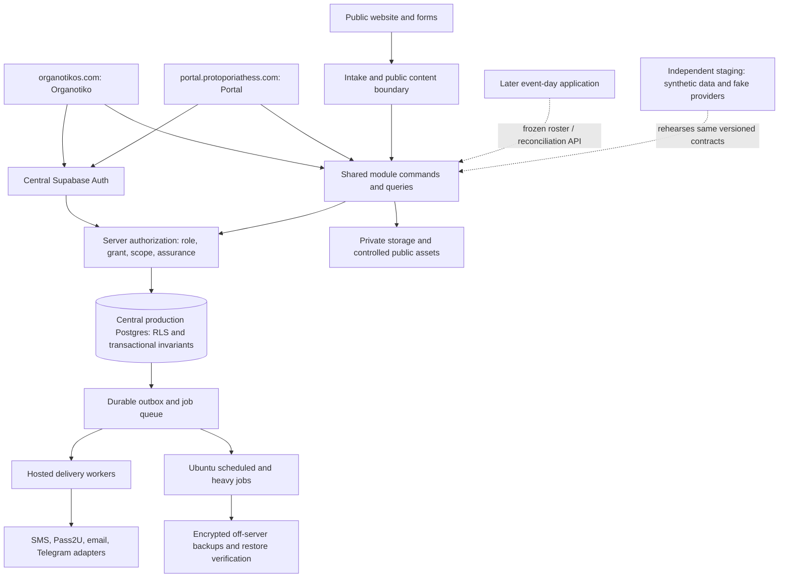

# Organotiko architecture and read-only audit

## Two applications and migration-first delivery — confirmed 2026-11-03

- **Organotiko: `organotikos.com`**. Independent application for organizational workflows, member management, Bluepass and offers, plus user creation for both applications.
- **Portal: `portal.protoporiathess.com`**. Independent application for tasks/operational teams, events, finance, newsletter, SMS and other operational administration.
- **One shared central production database**, with shared Auth/services and enforced application permissions; independent staging. Two domains mean separate applications and deployment entry points, not separate production databases. This records target domains; it does not claim DNS or hosting has been configured.
- **Migrate existing functionality; build only new Organotiko capabilities from scratch.** Reuse the supplied Portal implementation and website member/Bluepass/offer implementation, preserving behavior and adapting shared data, identity, authorization and application integration as necessary. Do not replace existing modules with newly invented implementations. Required compatibility and security changes are migration work, not authorization for a wholesale rewrite.
- New implementation centers on the organizational grid, nuclei, review sessions, academic-year/EFΕΚΘ workflows, assembly analysis, organizational reporting and their shared identity links. Central account creation for both apps is integrated in Organotiko; Portal does not retain its own provisioning path.
- Migrate shared database schemas/data and existing accounts through staging rehearsals, provenance mapping and reconciliation. Existing public website forms remain operational. Production changes and deployment still require explicit approval and a tested backup/restore plan.

## Current application split — confirmed 2026-11-03

This user clarification supersedes every earlier requirement for Organotiko to be a complete Portal/website-admin superset. Older source inventories remain evidence of existing functionality, not instructions to duplicate Portal screens in Organotiko.

| Application | Confirmed scope |
|---|---|
| Organotiko | All organizational workflows: student grid/search, nuclei, review sessions, academic years, EFΕΚΘ registrations, assembly analysis and organizational reports; complete member management; complete website-equivalent Bluepass management including offers; central user creation for **both** applications. |
| Separate Portal | Tasks and operational teams, operational events, finance, newsletter, SMS, and other operational/website administration outside the Organotiko scope. |
| Public website | Existing public forms/content/offers remain operational; management ownership follows the split above. |

Both apps share the planned central database/Auth/services and permission model; staging remains separate. Account creation is available only through Organotiko, including Portal-only users. Portal must not expose an independent create/invite/bulk-provision path. Organotiko TOTP, Portal access policy, provenance and migration/backup safeguards remain required. Splitting the UI does not grant cross-application access automatically.

Member/Bluepass parity includes the existing website workflows and wallet/card/offer capabilities. Cross-module actions such as SMS/newsletter execution belong to Portal; their navigation/context handoff must be designed without copying delivery screens into Organotiko or weakening authorization. Organizational assemblies and their analysis remain in Organotiko; operational event planning belongs to Portal. Organotiko reports cover its own domains; operational/financial reports remain in Portal.

Status: navigation/plans updated; member and Bluepass functionality is still planned, not implemented. No existing Portal/website repository or production system was modified by this scope update.

Audit date: 2026-11-02. Requirements authority: [PROJECT_SPEC.md](PROJECT_SPEC.md) and [AGENTS.md](AGENTS.md).

Status labels: **[R]** confirmed requirement; **[E]** confirmed in supplied source/export, not verified in production; **[P]** proposed design; **[A]** assumption requiring validation; **[D]** unresolved consequential decision; **[G]** missing evidence / gate. No application code, database connections, migrations, deliveries, or deployments were performed during this audit.

## Evidence boundary

The application will be built in this repository [R]. The inspected source snapshots are:

| Source | Snapshot | Evidence and limitation |
|---|---|---|
| Portal, `../organizer-kypros` | Git `0d21780793427b46002b7ffb4da6592949167a11`, clean working tree | React 19 / TypeScript / Vite 7; Cloudflare Worker; numbered SQL files 001–021 and tests. Migration intent is available; a current deployed schema export is not. |
| Website, `../website` | Git `01e3f006ceb1f97bcea85774d18ba8dc35bc5bdc`, clean working tree | React 19 / JavaScript / Vite 8; Netlify functions; captured `supabase/migrations/20261028233714_remote_schema.sql`. Export reflects its capture, not proof of current live state. |
| Legacy Access | Not supplied | No verified columns, keys, relationships, queries, forms, macros, reports, or year-transition logic. |
| Sheets event-day system | Not supplied; deferred | No verified schema or workflow. |

Repository documents and code were inspected locally. Environment files, credential values, production databases and provider accounts were not accessed. No read-only live inspection is claimed. The new Organotiko directory is not currently a Git repository; no repository initialization was performed. The website's `SCHEMA.sql` is explicitly historical/incomplete according to `docs/database-development.md`; use the captured remote schema as stronger evidence. The export includes FDW backup objects and quiz dependencies; it must not be replayed blindly.

## Confirmed target

[R] Organotiko owns organizational work, member management, Bluepass and offers, plus central user creation for both apps. Portal owns tasks/operational teams/events, finance, newsletter, SMS and other administration. Each owning app must preserve its complete source workflows; the public website remains operational.

[R] One central production Supabase project; independent staging with 200–300 synthetic students; shared identity and business logic; granular authorization; server/database-enforced TOTP for Organotiko. Office server failure pauses its jobs without taking interactive applications offline. Election-day and MASTER policy are deferred.

## Proposed topology [P]

Diagram describes the target; staging never connects to production data or delivery credentials. Shared API boxes are logical boundaries, not a requirement for a single new server. Preserve appropriate Supabase RPCs and RLS reads; privileged provider/account actions run server-side.

## Code and module organization [P]

Use this repository for an incremental TypeScript workspace, with `apps/organotiko`, shared `packages/domain`, `packages/contracts`, `packages/ui`, `packages/authz`, module packages, integration adapters, and versioned database definitions. Paths are recommendations only; no scaffold has been created. Keep existing repositories operational initially. Extract tested behavior behind adapters, then consume shared packages in Organotiko and Portal as compatibility allows. Different Vite/React toolchain versions require an explicit dependency assessment before consolidation.

Module owners and source workflows are in [MODULE_MATRIX.md](MODULE_MATRIX.md). The database model is in [DATA_MODEL.md](DATA_MODEL.md). Do not unify Portal teams with nuclei, public content events with operational events, or three notions of membership merely because labels overlap.

## Authorization and identity boundary

[R] ORGANOTIKOS accounts are equal, highest, and receive all Organotiko capabilities; Portal access remains governed by explicit application grants. MASTER has no invented Organotiko grants. Portal ADMIN / ΗΓΕΣΙΑ / ΣΥΝΤΟΝΙΣΤΗΣ / ΜΕΛΟΣ remain distinct; granular feature grants permit restricted Bluepass/newsletter access without broad promotion.

[P] Authorization checks principal, capability, resource scope and assurance on every command and query. Bind grants to trusted server-owned records, never user-editable metadata. Restrict both row and field exposure, including exports, search, logs, custom fields and realtime subscriptions. Organotiko-only resources require verified TOTP assurance at the database/server boundary. Merely opening a different hostname cannot be an authorization signal. Shared Portal functions may remain usable without MFA per requirement; document their resource scope so an AAL1 token cannot retrieve organizational-only data through a shared endpoint.

[R/P] Central account management provisions temporary passwords, enforces initial change server-side, supports bulk creation, resets without MFA bypass, and permanently deletes credentials/sessions independently of people. Model recovery separately: ten single-use hashed codes, atomic consumption, one-time display, rate limits, and audited supervised reset by another ORGANOTIKOS. Recovery authorization must not accept ordinary AAL1 sessions as equivalent to a completed TOTP challenge. Exact recovery/session mechanism requires staging validation [G].

[D] Shared Auth does not resolve cross-domain login automatically. Choose explicit redirect-based login/session exchange or separate sign-ins against the same identity after domain and threat-model review. Do not transfer refresh tokens in query strings or assume cross-site cookie sharing.

## Material source findings [E]

| Finding | Evidence | Integration implication |
|---|---|---|
| Website privileged proxies have no caller authorization in their handlers | `netlify/functions/send-sms.cjs`, `pass2u.cjs`; `notify-telegram.cjs` also accepts posted payload | Deployment protections are unknown. Before reuse, require authorized delivery commands; public notifications originate from validated persisted intake, with abuse controls. No live exploit test performed. |
| Website MFA gate exempts admin and tests enrollment | `src/components/admin/MfaGate.jsx` | This does not satisfy Organotiko's TOTP requirement. Implement assurance enforcement independently; preserve deliberate Portal policy. |
| Website invitation accepts admin/editor and has a VITE-prefixed service-key fallback | `netlify/functions/invite-user.cjs` | Centralize future provisioning; prohibit privileged keys in browser build variables. Presence of an actual exposed key was not checked or asserted. |
| Website export grants authenticated management of public events/members/news through broad policies | Remote schema, public policies near lines 1375–1395 | Inventory usage before retirement; deny broad inherited access in target. Role menus are not security proof. |
| Website has parallel `public` and `external` members/news, plus FDW backup and quiz | Remote schema; frontend `.schema('external')` calls | Determine authoritative rows and dependencies before import; never union duplicates automatically. |
| Website logging can originate from browser | `src/lib/actionLogger.js`; export `write_own_log` policy | Preserve legacy provenance but distinguish client assertions from trusted server audit. |
| Portal security evolved across migrations | SQL 004, 007, 008, 015 and Worker token/profile checks | Evaluate final effective definitions, grants and role tests; old role documents are not authoritative. |
| Portal finance receipts were removed conditionally | SQL 020; current FinancePage table list excludes files | Do not recreate receipts as a confirmed current feature; verify applied state and residual storage. |

These findings are integration gates, not production modifications. Migration SQL and source-level checks do not prove deployed safety or successful end-to-end behavior.

## UI and reliability decisions [P]

Build the Organotiko shell around a home function chooser, persistent collapsible sidebar, command shortcuts and a virtualized, paginated keyboard grid. Keep core operations free of unnecessary animation. Shared domain logic should not force Portal's current layout into Organotiko. Accessible focus management, composition-aware uppercase input, mobile quick search and explicit conflict resolution are first-class acceptance criteria.

Use field-level compare-and-set commands with transactional audit, idempotency keys and explicit conflict responses. Durable queue leases, bounded retries and an uncertain-delivery state prevent blind resend after provider timeouts. Store provider references without treating acceptance as delivery. Ubuntu jobs use least-privilege identities; hosted interactive requests must not synchronously depend on Ubuntu.

## Unresolved architecture decisions

[D] Central project's destination (retain Portal, retain website, or new project); domain hosting/DNS configuration; account migration/password strategy; granular website-role mapping; retention and lawful identity matching; public event publishing relationship; quiz ownership; recovery design; backup destinations and operating costs. See the decision register in [MIGRATION_PLAN.md](MIGRATION_PLAN.md). Missing evidence blocks destructive consolidation, not documentation or isolated synthetic development.
