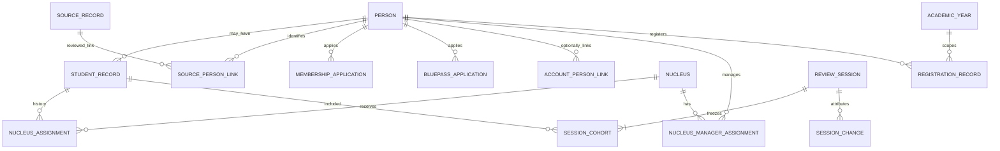

# Data model and identity mapping

## Two applications and migration-first delivery — confirmed 2026-11-03

- **Organotiko: `organotikos.com`**. Independent application for organizational workflows, member management, Bluepass and offers, plus user creation for both applications.
- **Portal: `portal.protoporiathess.com`**. Independent application for tasks/operational teams, events, finance, newsletter, SMS and other operational administration.
- **One shared central production database**, with shared Auth/services and enforced application permissions; independent staging. Two domains mean separate applications and deployment entry points, not separate production databases. This records target domains; it does not claim DNS or hosting has been configured.
- **Migrate existing functionality; build only new Organotiko capabilities from scratch.** Reuse the supplied Portal implementation and website member/Bluepass/offer implementation, preserving behavior and adapting shared data, identity, authorization and application integration as necessary. Do not replace existing modules with newly invented implementations. Required compatibility and security changes are migration work, not authorization for a wholesale rewrite.
- New implementation centers on the organizational grid, nuclei, review sessions, academic-year/EFΕΚΘ workflows, assembly analysis, organizational reporting and their shared identity links. Central account creation for both apps is integrated in Organotiko; Portal does not retain its own provisioning path.
- Migrate shared database schemas/data and existing accounts through staging rehearsals, provenance mapping and reconciliation. Existing public website forms remain operational. Production changes and deployment still require explicit approval and a tested backup/restore plan.

## Current application split — confirmed 2026-11-03

This user clarification supersedes every earlier requirement for Organotiko to be a complete Portal/website-admin superset. Older source inventories remain evidence of existing functionality, not instructions to duplicate Portal screens in Organotiko.

| Application | Confirmed scope |
|---|---|
| Organotiko | All organizational workflows: student grid/search, nuclei, review sessions, academic years, EFΕΚΘ registrations, assembly analysis and organizational reports; complete member management; complete website-equivalent Bluepass management including offers; central user creation for **both** applications. |
| Separate Portal | Tasks and operational teams, operational events, finance, newsletter, SMS, and other operational/website administration outside the Organotiko scope. |
| Public website | Existing public forms/content/offers remain operational; management ownership follows the split above. |

Both apps share the planned central database/Auth/services and permission model; staging remains separate. Account creation is available only through Organotiko, including Portal-only users. Portal must not expose an independent create/invite/bulk-provision path. Organotiko TOTP, Portal access policy, provenance and migration/backup safeguards remain required. Splitting the UI does not grant cross-application access automatically.

Member/Bluepass parity includes the existing website workflows and wallet/card/offer capabilities. Cross-module actions such as SMS/newsletter execution belong to Portal; their navigation/context handoff must be designed without copying delivery screens into Organotiko or weakening authorization. Organizational assemblies and their analysis remain in Organotiko; operational event planning belongs to Portal. Organotiko reports cover its own domains; operational/financial reports remain in Portal.

Status: navigation/plans updated; member and Bluepass functionality is still planned, not implemented. No existing Portal/website repository or production system was modified by this scope update.

Audit date: 2026-11-02. Requirements authority: [PROJECT_SPEC.md](PROJECT_SPEC.md) and [AGENTS.md](AGENTS.md).

Labels: **[R]** confirmed requirement; **[E]** source/export evidence, not live verification; **[P]** proposal; **[A]** assumption; **[D]** unresolved decision; **[G]** missing evidence/gate. This is a design document, not executable DDL or authorization to migrate.

## Source schemas [E]

Portal sources: `../organizer-kypros/supabase/001_schema.sql` through `021_cancel_expected_removes_record.sql`, `src/types.ts` and page queries. The following is a migration-derived inventory, not a reconstructed live schema. Later function definitions override earlier ones; current application queries are additional evidence.

| Source group | Tables / relationships to preserve |
|---|---|
| Identity | `public.profiles`: Auth user linkage, username/technical email, full name, active, base role, position and independent permission flags including finance/SMS |
| Groups | `teams`, `team_members`: team/user membership and coordinator scope |
| Work | `tasks`, `task_assignees`, `task_checklist`, `task_comments`, `notifications`; creator/assignee/commenter and task links |
| Events | `events`, `event_task_templates`, `event_kinds`; tasks link event/template; unique event/template generation prevents duplicate tasks |
| Messaging | `sms_sender_ids`, `sms_exclusions`, `sms_contacts`, `sms_campaigns`, `sms_recipients`; campaign/recipient lifecycle; personalized payload additions and cleanup in SQL 011 |
| Finance | `finance_accounts`, `finance_categories`, `finance_registers`, `finance_transactions`, `finance_legs`, `finance_allocations`, `finance_expected`, `finance_month_closes`, `finance_reconciliations`, `finance_audit`, `finance_historical_sources` |
| Audit | `audit_log`, finance and SMS audit functions; account events through Worker |
| Removed by migration intent | `finance_files` and receipt bucket/policies in SQL 020; verify actual applied state before declaring absent |

Website baseline: `../website/supabase/migrations/20261028233714_remote_schema.sql`.

| Source object | Confirmed shape / semantic warning |
|---|---|
| `external.members` | UUID ID; textual member_id; names/father/national ID; DOB, CY/GR addresses and phones, email; university/department/school/year_of_entry; pending/approved/deleted; soft deletion/reason, comment, flags; Pass2U ID/URL and member-card creation time |
| `external.bluepass_applications` | UUID; names, academic attributes, email/phones; pending/approved/deployed/deleted; approval/deployment/registration times, barcode/batch/SMS flag; flags, soft deletion, Pass2U ID/URL |
| `external.newsletter_subscribers` | UUID; name, phone, department; independent event/generic/student alert booleans; deletion markers |
| `external.newsletter_messages` | UUID; message/groups/count/sender, department, scheduled/sent timestamps, status/error; no per-recipient delivery ledger is established by this table alone |
| `external.bluepass_offers` | UUID; title/description/category/discount/image/link; active/order; address and coordinates |
| `external.news`, `external.website_config`, `external.action_logs` | Content; keyed JSON configuration; actor ID/email/role/display name, action/entity/details/page/time |
| `public.profiles` | Auth UUID PK/FK with cascade on Auth deletion; role, display_name, email, optional member_id. Export does not establish a member_id FK |
| `public.members`, `public.news`, `public.events` | Parallel member/news tables; public events are date/location/content, unlike Portal team-scoped staged events. Determine usage and authority before consolidation |
| `external_fdw_backup.*` | Eight foreign-table definitions, including duplicated members/newsletter/etc. Not a second set of authoritative rows to import automatically; external server/user mapping dependencies need separate inventory |
| `quiz.hosts`, `quiz.quizzes`, `quiz.players` | Auth-linked hosts and owners; quizzes with JSON questions/code/status; players with quiz/token uniqueness. Quiz owner FK can obstruct Auth deletion; do not bypass by deleting quizzes |

Export includes extensions, functions, policies and grants, but is not a complete project backup. Custom `protoporia_jobs` role is referenced; role credentials/attributes, Auth settings/users, Storage contents and active scheduled jobs are not established. Historical `SCHEMA.sql` is not authoritative.

Website duplicate-check functions return match flags; they do not establish identity. Exported member/Bluepass date_registered defaults add a fixed three-hour offset in places; preserve originals, establish timezone semantics and test DST before converting. No automatic timestamp correction [D].

## Proposed target entities [P]

Names below are conceptual and may use logical schemas after compatibility validation. Do not deploy them as SQL.

| Domain | Entities, keys and important constraints |
|---|---|
| People | `person(id UUID)`, `person_contact`, restricted identity attributes; `source_record(source_system, source_entity, source_key, import_batch, raw_fingerprint)` unique by source tuple; `source_person_link` with reviewer/time/evidence and supersession history |
| Student | `student_record(id, person_id, academic_unit_id, entry_year, operational_status, archived_at)`; optional for a person. Student cardinality across institutions remains [D]; do not prematurely enforce one lifetime row per person |
| Academic reference | `university`, `school`, `department`, `academic_year`, versioned `year_code_rule` and `student_year_history`; import unresolved codes unchanged |
| Nuclei | `nucleus_category`, `nucleus`, `nucleus_manager_assignment`, `student_nucleus_assignment(valid_from, valid_to, primary_or_secondary)`; manager references person, optional account separately; prevent overlapping primary assignments; secondary multiplicity awaits policy |
| Protoporia | `membership_application`, `protoporia_membership`, `membership_status_history`; source member identifiers preserved as identifiers, never confused with EFΕΚΘ |
| Bluepass/wallet | `bluepass_application`, lifecycle history, deployment batches; `wallet_pass(subject_kind, subject_id, provider, model_ref, pass_ref, link, state)`; preserve member and Bluepass cards independently |
| EFΕΚΘ | `association_membership` independently controlled current boolean with change history; `registration_period`; annual `registration_record` with date/source and initial intention; uniqueness and repeat-registration/correction semantics unresolved |
| Assemblies | `assembly`, `assembly_person_intention`, `assembly_attendance`, `assembly_outcome`; versioned symbol dictionary; no conflation of legacy 9 with actual attendance without reviewed mapping |
| Snapshots | `aggregate_snapshot(as_of, scope_definition, dictionary_version)`, immutable metrics; daily/manual origin and source watermark; retained historical academic/faction dimensions prevent current status altering old totals |
| Grid | `field_definition(type, constraints, permissions, normalization)`, typed `field_value`; `saved_view(owner, sharing, filter_ast, sort, columns, default)`; whitelist query fields/operators, no arbitrary SQL |
| Notes/audit | Latest note plus attributable versions; append-only authorized mutation records with subject, actor surrogate, request ID, field delta, timestamp and optional session ID; sensitive values limited by retention/access |
| Sessions | `review_session`, immutable `session_cohort`, `session_baseline`, unique `session_examined(session_id, student_id)`, `session_change`, `session_report_template`, immutable completion snapshots |
| Teams/work/events | Retain distinct team membership, task/checklist/comment/assignee/notification and operational event/template/type models; reference central principal and optionally linked person |
| Finance | Preserve ledger/register/legs/allocations/expected/month-close/reconciliation/audit/import-source relationships and numeric precision; no lossy conversion to a single income/expense table |
| Website | Content/public event, offer, typed website configuration and public-safe views; operational event publication link optional rather than automatic table merge |
| Messaging | Contact lists/exclusions/sender IDs; campaign, recipient, provider attempt/result, consent/preference evidence, schedule; immutable outbox, leased job, idempotency key, uncertain state |
| Accounts | Auth principal plus application account, capability grants and scope; optional account-person link; application actor surrogate independent from credential lifetime; recovery-code hashes and audited recovery events |

## Relationship sketch [P]

## Identity mapping contract [R/P]

| Source identity | Target mapping | Forbidden inference |
|---|---|---|
| Access primary key (unknown) | Stable source tuple → reviewed person/student | Row order/name as permanent key |
| Portal Auth UUID/profile | Source-project-qualified principal → central account; optional person link | Username or position title grants Organotiko privileges |
| Website Auth UUID/profile | Separate principal mapping and action-level grant review | Same UUID/email across projects automatically means same authorized account |
| Website member/application UUID and member_id | Preserve source records and statuses → reviewed person, distinct membership/application | Membership proves student record or EFΕΚΘ registration |
| Bluepass UUID/pass reference | Reviewed person link plus preserved application/pass | Email/phone match automatically merges persons or cards |
| Newsletter subscriber UUID | Subscription/preference identity, optional reviewed person link | Phone implies blanket SMS consent or same person forever |

Normalize comparison copies (Greek case/diacritics, phone country formats, email); retain source text. Exact stable source identifiers make reruns idempotent, not cross-source identity proof. Generate candidates using permitted identifiers and context, show collisions and conflicting attributes, require human confirmation for ambiguity and approved enrichment. Record rejected matches too. No destructive overwrite or silent fuzzy merge. Sensitive identifiers require explicit lawful-access and retention decisions [D].

## Transactional invariants [R/P]

- Enforce globally one active review session through a database uniqueness/locking invariant; concurrent starts cannot both succeed. Freeze cohort atomically at actual start. Define paused-session global exclusivity before implementation [D].
- Session filters/sort/visible columns affect presentation only. Store unique examined set; changing filters cannot change frozen denominator. Completed sessions lock; cancelled cannot resume; saved edits survive cancellation. Session summaries use request/session attribution rather than all edits during the time interval.
- Different-field edits apply narrow patches; same-field comparison checks the previously read value/version and returns conflict. No whole-row last-write-wins. Audit and mutation commit together.
- Annual advancement is previewed, manually initiated, idempotent per approved operation and rollbackable by recorded batch before dependent edits. It does not clear EFΕΚΘ status. New annual registration values start blank; past years persist.
- Archive/status 0 alters operational visibility, not historic cohort/registration/assembly denominators. Preserve raw unsupported legacy symbols without adding excluded ΚΦ/ΑΓ/ΜΠΕ/ΑΝΑΓ to supported new choices.
- Financial balances, allocations, reversals, locks and source provenance reconcile exactly at original precision. User deletion must not cascade into financial/work/event records.
- Credential deletion revokes sessions/factors/codes, removes Auth/account access, detaches optional links, and preserves only approved history via an actor surrogate. Inspect all FKs, including quiz ownership, before executing any deletion.

## Decisions that block final DDL [D/G]

Access schema and code dictionaries; N/N1/IEK/postgraduate transition rules; primary/secondary nucleus semantics and taxonomy; repeat EFΕΚΘ registration/correction rules and source values; current membership versus annual registration reconciliation; student cardinality; paused-session exclusivity; notes normalization exceptions; identity/retention policy; timestamp interpretation; website table authority; quiz dependencies; real Auth/Storage/project configuration and Portal applied schema. These remain explicit gaps, not invented columns.

## Proposed first read migration — 2026-11-04

Confirmed by read-only hosted inspection: PostgreSQL 17.11; no application tables
or Auth users. `supabase/migrations/20261104000100_organotiko_read_foundation.sql`
is a new-target proposal, not a discovered legacy schema or an applied production
change. It separates people, student records, nucleus categories/nuclei, dated
assignments and confirmed read-side membership links. The security-invoker student
view serves the initial UI contract. Independent EFΕΚΘ, Protoporia and Bluepass
flags remain distinct; unresolved membership links fail client validation.

The private read-access registry is a temporary narrow authorization foundation;
it grants no browser mutations and does not replace the planned granular permission
model, identity provenance ledger, member/Bluepass histories, audited write services,
manager associations, annual registrations or review-session persistence. No fuzzy
matching/import or initial administrator bootstrap is included. Those remain
unresolved and must be reviewed before production application/import.
